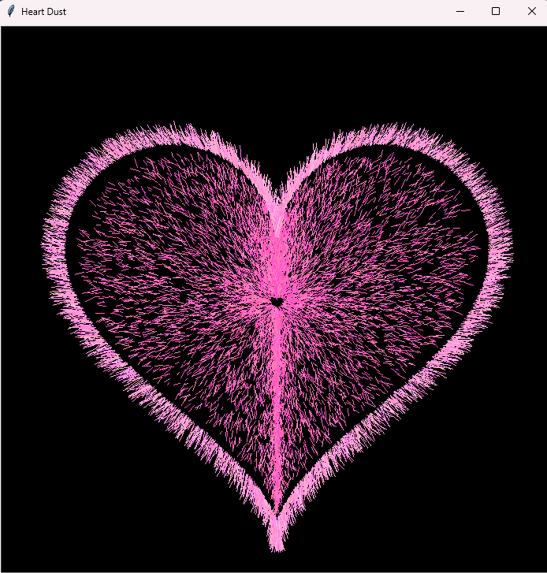

<div align="center">

# 💗 Heart Dust

**Un cœur de poussière rose, dessiné trait après trait avec Python et `turtle`.**




</div>

---

## ✨ Présentation

**Heart Dust** est un petit script générateur d'art : il dessine un cœur composé de **13 500 micro-traits roses** projetés au hasard sur fond noir, ce qui donne un effet de poussière d'étoiles, de pastel ou de craie qui se dépose peu à peu sur l'écran.

- 🐍 **Un seul fichier** : `main.py`
- 📦 **Zéro dépendance** : uniquement la bibliothèque standard de Python
- 🎲 **Chaque exécution est unique** grâce au hasard
- 🎬 **Animation fluide** : le cœur apparaît progressivement

## 🚀 Démarrage rapide

### Prérequis

- [Python 3](https://www.python.org/downloads/)
- `tkinter` (installé par défaut avec Python sous Windows et macOS)

### Lancement

```bash
git clone https://github.com/GhostNiro/heart-dust.git
cd heart-dust
python main.py
```

Une fenêtre de 700×700 px s'ouvre et le cœur se dessine tout seul. Ferme la fenêtre pour quitter.

> 💡 Sous Linux, si tu obtiens `ModuleNotFoundError: No module named 'tkinter'` :
> ```bash
> sudo apt install python3-tk
> ```

## 🎨 Comment ça marche ?

### 1. La courbe du cœur

Le contour du cœur est une **courbe paramétrique** classique :

$$x(a) = 16\sin^3(a)$$

$$y(a) = 13\cos(a) - 5\cos(2a) - 2\cos(3a) - \cos(4a)$$

avec `a` variant de `0` à `2π`. La fonction `heart(a, scale)` renvoie un point `(x, y)` de cette courbe, multiplié par un facteur d'échelle.

### 2. Deux passes de dessin

Le rendu est construit en deux étapes, chacune tirant des petits traits aléatoires :

| | Phase 1 : le **nuage** | Phase 2 : le **contour** |
|---|---|---|
| **Rôle** | Remplir l'intérieur du cœur | Dessiner une bordure légère et floue |
| **Nombre de traits** | 10 000 | 3 500 |
| **Échelle du cœur** | aléatoire, entre `0.5` et `15.5` | fixe, `16.9` |
| **Direction du trait** | vers l'extérieur ± 0.5 rad | vers l'extérieur ± 0.35 rad |
| **Longueur du trait** | 4 à 14 px | 10 à 32 px |
| **Décalage de départ** | aucun | ± 2 px |
| **Épaisseur** | 0.5 à 1.2 | 0.4 à 0.9 |
| **Couleur (RGB)** | `(1.0, 0.25–0.55, 0.65–0.85)` : rose soutenu | `(1.0, 0.45–0.75, 0.75–0.95)` : rose clair |

**L'astuce :** en tirant une échelle aléatoire à chaque point, la phase 1 génère une multitude de « cœurs imbriqués » qui remplissent tout l'intérieur. Chaque trait est ensuite orienté dans la direction du point depuis le centre (`atan2(y, x)`) avec un léger écart aléatoire, ce qui donne l'effet de poussière projetée vers l'extérieur.

### 3. Les performances

- `s.tracer(0)` désactive l'animation automatique de `turtle` (très lente).
- `s.update()` n'est appelé que tous les 150 à 200 traits pour rafraîchir l'écran par paquets.
- `p.hideturtle()` masque le curseur pour un rendu propre.

## 🛠️ Personnalisation

Tout se règle en modifiant quelques valeurs dans `main.py` :

| Je veux… | Je modifie… |
|---|---|
| Plus (ou moins) de poussière | `range(10000)` et `range(3500)` |
| Un cœur plus grand / plus petit | `r.uniform(0.5, 15.5)` et `16.9` |
| Une autre couleur | les valeurs de `p.pencolor(R, G, B)` (entre `0` et `1`) |
| Des traits plus longs, plus « éclatés » | `length = r.uniform(...)` |
| Un effet plus ou moins dispersé | le `r.uniform(-0.5, 0.5)` (angle) et `r.uniform(-2, 2)` (position) |
| Une animation plus rapide ou plus lente | `time.sleep(0.002)` et les `i % 200` / `i % 150` |
| Un autre fond | `s.bgcolor("black")` |

**Exemple : un cœur bleu glacé** 🧊

```python
p.pencolor(r.uniform(0.25, 0.55), r.uniform(0.65, 0.85), 1.0)
```

## 📁 Structure du projet

```
heart-dust/
├── assets/
│   └── preview.png   # aperçu du rendu
├── main.py           # tout le code du projet
├── LICENSE
└── README.md
```

## 💡 Idées d'amélioration

- [ ] Exporter l'image finale : `s.getcanvas().postscript(file="heart.ps")`
- [ ] Ajouter un effet de battement de cœur 💓
- [ ] Palette de couleurs en argument de ligne de commande
- [ ] Faire varier la couleur en dégradé du centre vers le bord
- [ ] Générer un GIF animé automatiquement

## 👤 Auteur

**GhostNiro** — [github.com/GhostNiro](https://github.com/GhostNiro)

Une idée, un bug, une amélioration ? Ouvre une [issue](https://github.com/GhostNiro/heart-dust/issues) ou propose une pull request. ⭐ Si le projet te plaît, une étoile fait toujours plaisir !

## 📄 Licence

Ce projet est distribué sous licence **MIT**. Tu peux l'utiliser, le modifier et le partager librement. Voir le fichier [LICENSE](LICENSE) pour les détails.

---

<div align="center">

Fait avec 💗 et beaucoup de petits traits par [GhostNiro](https://github.com/GhostNiro)

</div>
